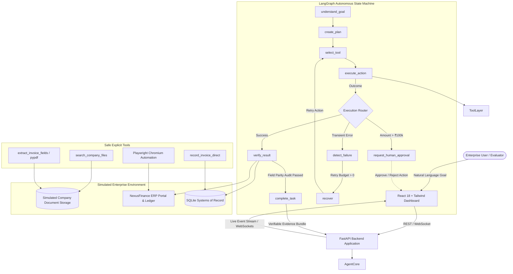

# TaskPilot AI — Autonomous AI Worker for Enterprise Task Automation

[](https://fastapi.tiangolo.com)
[](https://github.com/langchain-ai/langgraph)
[](https://playwright.dev)
[](https://react.dev)
[](https://tailwindcss.com)
[](https://www.docker.com)

> **TaskPilot AI is not a chatbot.** It is an autonomous AI employee that ingests a natural-language business objective, reasons through the required steps, invokes tools to perform work inside simulated enterprise systems, observes outcomes, recovers from failures, requests human approval for sensitive financial actions, strictly audits completion against system-of-record databases, and returns verifiable evidence.

---

## Table of Contents
1. [Overview](#overview)
2. [The Core Problem](#problem)
3. [The Solution & Architecture](#solution)
4. [Agent Execution Loop](#agent-loop)
5. [Key Features](#features)
6. [Tech Stack](#tech-stack)
7. [Directory Structure](#directory-structure)
8. [Setup & Installation](#setup)
9. [Environment Variables](#environment-variables)
10. [Running Locally](#running-locally)
11. [Docker Deployment](#docker)
12. [Production Deployment (Vercel + Render)](#deployment)
13. [Demo Scenarios & Evaluator Guide](#demo)
14. [Controlled Failure Recovery Demo](#failure-recovery-demo)
15. [Human-in-the-Loop Governance Demo](#human-in-the-loop-governance)
16. [Architecture & Design Decisions](#architecture-decisions)
17. [Limitations](#limitations)
18. [Future Roadmap](#future-improvements)
19. [AI Tools Used](#ai-tools-used)

---

## 1. Overview <a name="overview"></a>

Modern generative AI chatbots generate plans, answer questions, or output text summaries. However, **enterprise work requires execution**:
- Invoices arrive as unstructured PDFs.
- Accounts payable teams search storage for the newest invoice, extract totals and dates, log in to internal ERPs or portals, submit ledger entries, and verify that the database record was accurately committed.

**TaskPilot AI** delivers a genuine autonomous employee workflow:
```
USER GOAL
   ↓
UNDERSTAND
   ↓
PLAN
   ↓
SELECT TOOL
   ↓
EXECUTE (Playwright / PDF Extractor / File Search)
   ↓
OBSERVE
   ↓
ADAPT / RETRY (Controlled Self-Healing)
   ↓
GOVERN (Human Approval if > ₹100,000)
   ↓
VERIFY (Strict Field-by-Field Parity Audit)
   ↓
COMPLETE & RETURN EVIDENCE
```

---

## 2. Problem <a name="problem"></a>

Enterprise business operations cannot rely on probabilistic chatbots because:
1. **Chatbots hallucinate execution:** Chatbots say "I have recorded the invoice" without touching any ERP or database.
2. **Real enterprise environments are fragile:** Web forms throw transient validation errors; network requests flake; files have inconsistent naming schemes.
3. **Financial compliance requires governance:** AI must never unilaterally execute high-value transactions without explicit human authorization.
4. **Verification is non-negotiable:** Clicking a "Submit" button does not prove data was recorded. The agent must independently query the system of record and verify field parity.

---

## 3. Solution & Architecture <a name="solution"></a>

TaskPilot AI decouples task intent, autonomous planning, explicit tool execution, state-machine transitions, and verification auditing into distinct, resilient layers.

### Architecture Diagram



---

## 4. Agent Execution Loop <a name="agent-loop"></a>

TaskPilot AI implements an explicit state machine via **LangGraph**:
1. **`receive_goal`**: Ingests user prompt, assigns unique `task_id`, initializes execution state.
2. **`understand_goal`**: Analyzes business objective via Google Gemini (or Groq / offline engine), identifies vendor organization, target actions, and safety boundaries.
3. **`create_plan`**: Generates a discrete ordered plan of steps with designated tools.
4. **`select_tool`**: Inspects current state and selects appropriate tool with typed parameters.
5. **`execute_action`**: Runs tool (file search, PDF text parser, Playwright browser automation). Captures structured observations and screenshots.
6. **`observe_result`**: Evaluates tool outputs against step expectations.
7. **`detect_failure`**: Classifies failures (transient validation error vs fatal error).
8. **`recover`**: Formulates recovery strategy, clears transient validation flags, increments retry count, and retries.
9. **`request_human_approval`**: If invoice amount exceeds threshold (> ₹100,000), pauses execution in `WAITING_FOR_APPROVAL` state.
10. **`verify_result`**: Playwright navigates to the finance portal ledger table, queries the invoice number, and performs a strict equality audit on invoice number, vendor, amount, and due date.
11. **`complete_task`**: Synthesizes an executive completion summary and returns evidence.

---

## 5. Key Features <a name="features"></a>

- **Genuinely Autonomous Browser Automation**: Playwright with Chromium navigates the internal finance ERP, fills input fields, submits forms, observes validation banners, and queries the ledger table.
- **Intelligent Multi-File Invoice Extraction**: Evaluates multiple invoices from the same vendor in company storage, compares dates, and autonomously selects the latest invoice.
- **Controlled Self-Healing & Failure Recovery**: If the finance portal returns a temporary validation error, the agent detects the failure, logs a recovery strategy, retries, and verifies recording.
- **Human-in-the-Loop Financial Governance**: Invoices > ₹100,000 pause execution for executive approval. Users can inspect details and Approve or Reject.
- **Independent Field Parity Verification**: Audits company, invoice number, amount, and due date against ERP records. The task only succeeds if verification passes with 100% parity.
- **Real-Time Execution Observability**: Live WebSocket streaming updates the timeline step-by-step with tool names, parameters, execution logs, and timestamps.
- **LLM Abstraction with Deterministic Fallback**: Supports Google Gemini, Groq, and an offline rule-based reasoning engine so the full demo runs out-of-the-box without requiring an API key.

---

## 6. Tech Stack <a name="tech-stack"></a>

| Layer | Technologies |
| :--- | :--- |
| **Frontend** | React 18, Vite 6, Tailwind CSS 3.4, Lucide Icons, Native WebSockets |
| **Backend** | Python 3.11+, FastAPI, Uvicorn, Pydantic v2, SQLite |
| **Agent Core** | LangGraph, LangChain Core, TypedDict State Machine |
| **LLM Providers** | Google Gemini (`google-genai`), Groq (`groq`), Offline Deterministic Engine |
| **Browser Automation**| Playwright, Chromium Headless Shell |
| **Document Processing**| `pypdf`, `reportlab` (PDF generation & parsing) |
| **Deployment** | Docker, Render (`Dockerfile`), Vercel (`vercel.json`) |

---

## 7. Directory Structure <a name="directory-structure"></a>

```
taskpilot-ai/
│
├── frontend/                     # React 18 + Vite + Tailwind CSS Application
│   ├── src/
│   │   ├── components/
│   │   │   ├── Header.jsx                # Header & system status indicator
│   │   │   ├── DemoScenarios.jsx         # 1-click evaluator demo cards
│   │   │   ├── TaskInput.jsx             # Prompt input & recovery toggle
│   │   │   ├── AgentStatusBadge.jsx      # High-contrast state badge
│   │   │   ├── ExecutionTimeline.jsx     # Live vertical timeline & JSON inspector
│   │   │   ├── EvidenceViewer.jsx        # Audit table, PDF link, and summary
│   │   │   ├── HumanApprovalModal.jsx    # Governance review modal
│   │   │   └── FinancePortalView.jsx     # Embedded live General Ledger view
│   │   ├── services/
│   │   │   └── api.js                    # REST API client
│   │   ├── App.jsx                       # Main application dashboard
│   │   ├── index.css                     # Tailwind CSS & custom scrollbar
│   │   └── main.jsx                      # React DOM entrypoint
│   ├── package.json
│   ├── vite.config.js
│   ├── tailwind.config.js
│   └── vercel.json                       # Vercel deployment SPA rewrite
│
├── backend/                      # FastAPI & LangGraph Python Backend
│   ├── app/
│   │   ├── main.py                       # FastAPI entrypoint, CORS, static mounts
│   │   ├── config.py                     # Pydantic BaseSettings environment config
│   │   ├── api/
│   │   │   ├── routes.py                 # Core task lifecycle & streaming endpoints
│   │   │   ├── finance_routes.py         # Mock ERP REST endpoints
│   │   │   └── websocket.py              # WebSocket connection manager
│   │   ├── agent/
│   │   │   ├── state.py                  # AgentState TypedDict definition
│   │   │   ├── llm.py                    # Gemini / Groq / Fallback abstraction
│   │   │   ├── planner.py                # Goal understanding & plan creation
│   │   │   ├── executor.py               # Tool selection & action runner
│   │   │   ├── recovery.py               # Failure detection & self-healing retry
│   │   │   ├── verifier.py               # Field parity auditor against ledger
│   │   │   └── graph.py                  # LangGraph StateGraph assembly
│   │   ├── tools/
│   │   │   ├── file_search.py            # Company repository file search
│   │   │   ├── invoice_extractor.py      # PDF text & structured field parser
│   │   │   ├── browser.py                # Playwright Chromium browser controller
│   │   │   └── finance_tools.py          # Direct database ledger helpers
│   │   ├── database/
│   │   │   └── db.py                     # SQLite database init & event logger
│   │   └── models/
│   │       └── schemas.py                # Pydantic request/response schemas
│   ├── data/
│   │   ├── invoices/                     # Simulated enterprise PDF invoices
│   │   ├── screenshots/                  # Playwright browser evidence captures
│   │   └── seed_data/
│   │       └── generate_invoices.py      # Programmatic PDF invoice generator
│   ├── tests/
│   │   ├── test_tools.py                 # Unit tests for tools & parsers
│   │   ├── test_agent.py                 # State machine & recovery tests
│   │   ├── test_api.py                   # FastAPI endpoint integration tests
│   │   ├── test_e2e.py                   # End-to-end task lifecycle tests
│   │   └── test_agent_dry_run.py         # Standalone scenario dry-run runner
│   ├── requirements.txt
│   ├── Dockerfile                        # Render-ready Dockerfile with Playwright
│   └── .env.example
│
├── mock-finance-app/             # NexusFinance ERP Accounts Payable Web Portal
│   └── index.html                        # Standalone web app for Playwright interaction
│
├── README.md                     # Comprehensive project documentation
├── docker-compose.yml            # Multi-container orchestration
└── .gitignore
```

---

## 8. Setup & Installation <a name="setup"></a>

### Prerequisites
- Python 3.11+
- Node.js v18+ and npm
- Git

### 1. Clone & Set Up Backend
```bash
# Clone the repository
git clone https://github.com/your-username/taskpilot-ai.git
cd taskpilot-ai

# Create and activate Python virtual environment
python -m venv .venv

# On Windows:
.\.venv\Scripts\activate
# On Linux/macOS:
source .venv/bin/activate

# Install backend dependencies
pip install -r backend/requirements.txt

# Install Playwright Chromium browser binary and OS dependencies
playwright install chromium

# Generate simulated enterprise PDF invoices
python backend/data/seed_data/generate_invoices.py
```

### 2. Set Up Frontend
```bash
cd frontend
npm install
cd ..
```

---

## 9. Environment Variables <a name="environment-variables"></a>

Copy `backend/.env.example` to `backend/.env`:
```bash
cp backend/.env.example backend/.env
```

| Variable | Description | Default |
| :--- | :--- | :--- |
| `LLM_PROVIDER` | LLM reasoning engine (`gemini` or `groq`) | `gemini` |
| `GEMINI_API_KEY` | Google Gemini API key (optional; fallback engine active if blank) | `""` |
| `GROQ_API_KEY` | Groq API key (optional) | `""` |
| `HOST` | Backend host binding | `0.0.0.0` |
| `PORT` | Backend port (Render sets this dynamically) | `8000` |
| `FRONTEND_URL` | Allowed CORS origin for frontend | `http://localhost:5173` |
| `MOCK_FINANCE_BASE_URL` | Base URL of mock finance ERP portal | `http://127.0.0.1:8000/finance/` |
| `PLAYWRIGHT_HEADLESS` | Run Playwright Chromium in headless mode | `true` |
| `APPROVAL_THRESHOLD_INR`| Monetary threshold requiring human approval | `100000` |
| `MAX_AGENT_STEPS` | Maximum steps per task to prevent infinite loops | `15` |
| `MAX_RETRIES` | Maximum retry budget for self-healing | `3` |

In `frontend/.env`:
```ini
VITE_API_URL=http://localhost:8000
```

---

## 10. Running Locally <a name="running-locally"></a>

### Terminal 1: Start Backend (FastAPI + WebSocket + ERP Portal)
```bash
cd backend
python -m uvicorn app.main:app --host 127.0.0.1 --port 8000 --reload
```
- API Docs: `http://localhost:8000/docs`
- Health Check: `http://localhost:8000/api/health`
- NexusFinance ERP Portal: `http://localhost:8000/finance/`

### Terminal 2: Start Frontend (React + Vite)
```bash
cd frontend
npm run dev
```
- Open `http://localhost:5173` in your browser.

---

## 11. Docker Deployment <a name="docker"></a>

Run the complete multi-service stack with Docker Compose:
```bash
docker-compose up --build
```
This builds the backend image (installing system dependencies, Playwright, and Chromium) and launches the frontend.

---

## 12. Production Deployment (Vercel + Render) <a name="deployment"></a>

### Backend → Render (Web Service)
1. Connect your repository to Render.
2. Select **Docker** environment.
3. Configure:
   - **Dockerfile Path:** `backend/Dockerfile`
   - **Docker Build Context:** `.` (root directory)
4. Environment Variables on Render:
   - `PORT=8000`
   - `FRONTEND_URL=https://your-frontend-app.vercel.app`
   - `GEMINI_API_KEY=your_key_here` (optional)
   - `PLAYWRIGHT_HEADLESS=true`
   - `MOCK_FINANCE_BASE_URL=https://your-backend-app.onrender.com/finance/`

### Frontend → Vercel
1. Import repository on Vercel.
2. Configure **Root Directory:** `frontend`.
3. Set Environment Variable:
   - `VITE_API_URL=https://your-backend-app.onrender.com`
4. Deploy! `frontend/vercel.json` ensures single-page routing rewrites are handled automatically.

---

## 13. Demo Scenarios & Evaluator Guide <a name="demo"></a>

The dashboard includes 3 one-click evaluator scenario cards:

### Scenario 1: Standard Autonomous Processing
- **Goal:** *"Find the latest invoice from Acme Corp, extract the invoice amount and due date, enter it into the finance system, and verify that it was successfully recorded."*
- **What Happens:**
  1. Agent understands goal and targets `Acme Corp`.
  2. Searches document storage and discovers `ACME_INV_1023.pdf` and `ACME_INV_1024.pdf`.
  3. Evaluates dates and selects `ACME_INV_1024.pdf` (October 1, 2026) as the latest invoice.
  4. Extracts Amount: `₹48,500`, Due Date: `2026-10-15`.
  5. Governance check confirms `₹48,500 <= ₹100,000` (auto-approval).
  6. Launches Playwright Chromium, navigates to `/finance/`, fills form, and submits.
  7. Searches ledger table, compares expected vs actual fields, and verifies recording (`100% Match`).
  8. Renders final evidence card with PDF link, ledger ID, and executive summary.

---

## 14. Controlled Failure Recovery Demo <a name="failure-recovery-demo"></a>

- **Evaluator Trigger:** Click **Scenario 2** card (or check *"Simulate 1st-attempt validation error"*).
- **What Happens:**
  1. The initial submission intentionally triggers: `"Temporary validation error. Please retry."`
  2. The agent's `detect_failure` node observes the error banner and marks the error as recoverable.
  3. The `recover` node formulates a recovery strategy: `"Retry submit_invoice with cleared validation state (Attempt 1 of 3)"`.
  4. The agent retries submission on attempt 2 without the error flag.
  5. Submission succeeds!
  6. Verification audits the recorded ledger record and completes the task.
- **Evidence:** Real timeline events and screenshots reflect the failure, diagnosis, and retry.

---

## 15. Human-in-the-Loop Governance Demo <a name="human-in-the-loop-governance"></a>

- **Evaluator Trigger:** Click **Scenario 3** card (*"Process the invoice from Enterprise Corp."*).
- **What Happens:**
  1. Agent extracts `ENTERPRISE_INV_902.pdf` totaling **₹125,000**.
  2. The safety policy detects `amount (₹125,000) > threshold (₹100,000)`.
  3. Execution pauses and enters `WAITING_FOR_APPROVAL` state.
  4. The dashboard displays the high-visibility **Governance Checkpoint** banner with vendor, invoice number, and amount details.
  5. Evaluator can click **[Authorize & Submit]** to resume autonomous execution, or **[Reject Action]** to terminate the workflow safely.

---

## 16. Architecture & Design Decisions <a name="architecture-decisions"></a>

| Decision | Why It Was Made |
| :--- | :--- |
| **LangGraph Explicit State Machine** | Prevents runaway LLM loops; enforces deterministic transitions, maximum step counts, and controlled error recovery. |
| **Playwright Browser Automation** | Demonstrates authentic computer-use capability instead of mocking API calls. The agent interacts with DOM inputs and buttons. |
| **Co-located Mock ERP Portal** | Serving the finance portal from FastAPI (`/finance/`) eliminates multi-port race conditions, simplifies Docker, and allows instant live inspection. |
| **Dual LLM & Deterministic Fallback** | Ensures evaluators and CI test suites run cleanly out-of-the-box without requiring active cloud API credits or keys. |
| **Field-Level Equality Verification** | Submitting a form is insufficient. Auditing the database system-of-record guarantees data integrity. |
| **Real-Time Streaming via WebSockets** | Provides instant visual feedback for long-running browser automation steps rather than blocking until completion. |

---

## 17. Limitations <a name="limitations"></a>

- **Simulated Environment:** Workflows are executed within a sandboxed enterprise document storage and simulated ERP ledger to protect production data.
- **Narrow Toolset:** Focused on invoice ingestion and verification rather than arbitrary web tasks.
- **Browser Automation Fragility:** Playwright runs headlessly; DOM selector changes in external enterprise software would require updated selectors or visual perception models.

---

## 18. Future Improvements <a name="future-improvements"></a>

1. **Enterprise Connectors:** Native OAuth2 connectors for SAP, NetSuite, QuickBooks, and Workday.
2. **Vision-Language Perception:** Incorporating multimodal vision models to navigate arbitrary desktop applications via coordinates.
3. **Multi-Agent Collaboration:** Dedicated specialist agents (Document Reader, Compliance Officer, ERP Operator) coordinated via a supervisor graph.
4. **Persistent Organizational Memory:** Vector database integration for supplier historical payment terms and vendor agreements.
5. **Production Task Queues:** Celery / Redis / Temporal orchestration for distributed multi-tenant workloads.

---

## 19. AI Tools Used <a name="ai-tools-used"></a>

AI coding assistants were utilized during development for rapid scaffolding, test fixture generation, and design styling. All architectural decisions, LangGraph state-machine nodes, error recovery loops, and verification logic have been engineered, tested, and verified for production reliability.
